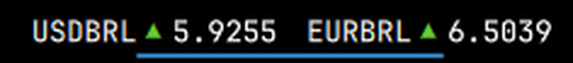
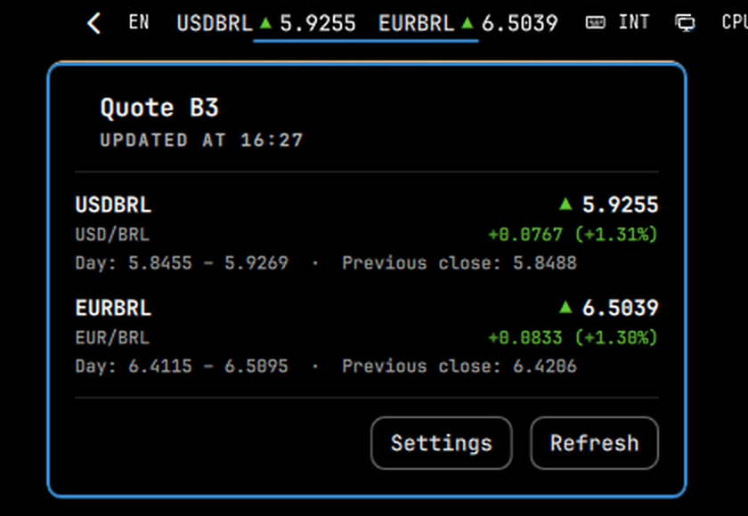

# Quote B3

An [Omarchy](https://omarchy.org/) shell bar widget that shows live prices
for up to **three Brazilian assets** right in the status bar, each as
`NAME ▲ price`:

- **B3 stocks, units and ETFs**: `PETR4`, `VALE3`, `ITUB4`, `TAEE11`, `BOVA11`, …
- **Currency pairs quoted in BRL**: `USDBRL`, `EURBRL`, `GBPBRL`, …
- **The Ibovespa index**: `IBOV`

Out of the box it shows **USDBRL** and **EURBRL**.



## Features

- **Trend arrow** next to every asset: ▲ up, ▼ down, ■ unchanged versus the
  previous close, colored with your current theme's green and red (can be
  turned off).
- **Pick assets by typing their name**: right-click the widget, type a company
  name or ticker (`petrobras`, `itau`, `dollar`, `VALE3`) and choose from live
  suggestions. No need to edit `shell.json`.
- **Left-click** opens a details panel with the full name, absolute and
  percent change, day range and previous close.
- **Middle-click** refreshes immediately.
- **Optional price alerts**: set a high and/or low limit per asset. When a
  price crosses one, you get a local notification with the price, time and
  day's change, and a short, soft chime. Once per crossing, never repeated
  while the price stays beyond the limit.
- Follows the Omarchy theme and language live: English and Portuguese
  strings, and the decimal separator of the selected language.
- One small HTTPS request per refresh for all assets, no API key needed.

## Screenshots

### Details (left-click)



## Install

```sh
omarchy plugin add https://github.com/Giuliano-sn/omarchy-quote-b3 --enable
```

Or clone manually into `~/.config/omarchy/plugins/` and enable it:

```sh
git clone https://github.com/Giuliano-sn/omarchy-quote-b3 \
  ~/.config/omarchy/plugins/io.github.giuliano-sn.quote-b3
omarchy plugin enable io.github.giuliano-sn.quote-b3 --section right
```

### Dependencies

Only `curl`, plus `pw-play` (PipeWire) or `paplay` for the alert chime and
`omarchy-notification-send` for notifications, all already present on every
Omarchy install. No services,
installers, background daemons or elevated privileges.

## Usage

| Action        | Result                                   |
| ------------- | ---------------------------------------- |
| Left-click    | Details panel                            |
| Right-click   | Settings (choose assets, refresh, colors)|
| Middle-click  | Refresh now                              |

### Choosing assets

1. Right-click the widget.
2. Type a name or ticker in the search field. Suggestions show B3 tickers,
   BRL currency pairs and the Ibovespa only. Typing an exact ticker such as
   `BBAS3` or `USDBRL` always offers it, even if the search does not list it.
3. Click a suggestion (or use ↑/↓ and Enter) to add it. Up to three assets.
4. **Remove** drops an asset; **Restore defaults** goes back to USDBRL and EURBRL.
5. Click **Save**.

### Price alerts

1. Right-click the widget and turn on **Notify me when a price crosses a limit**.
2. Each chosen asset gets two fields: **Above** and **Below**. Fill either,
   both or neither. Both `5,95` and `5.95` work; an invalid value turns red
   and is ignored.
3. Optionally turn off **Play a chime with the notification**.
4. Click **Save**.

How it fires:

- Prices are checked on every refresh (every `intervalMinutes`, default 5),
  so a crossing is noticed at the next refresh after it happens.
- When a price moves from inside a limit to beyond it, you get **one**
  notification such as *"PETR4 rose above 45.00 — Now 45.12 at 14:32 ·
  +0.95 (+2.15%) today"* and the chime plays once.
- The alert stays quiet while the price remains beyond the limit, and re-arms
  only after the price is back inside it by at least 0.25%, so a price
  bouncing on the line does not spam you.
- A limit that is already crossed when you save it, or when the shell starts,
  does not notify; only a new crossing does. Crossings that happen while the
  shell is not running or background refresh is off are not reported.

Try it with `omarchy-shell io.github.giuliano-sn.quote-b3 testAlert`.

### IPC

```sh
omarchy-shell io.github.giuliano-sn.quote-b3 refresh   # fetch now
omarchy-shell io.github.giuliano-sn.quote-b3 open      # details panel
omarchy-shell io.github.giuliano-sn.quote-b3 settings  # settings form
omarchy-shell io.github.giuliano-sn.quote-b3 close
omarchy-shell io.github.giuliano-sn.quote-b3 toggle
omarchy-shell io.github.giuliano-sn.quote-b3 testAlert # sample alert + chime
```

## Configuration

Everything is editable from the right-click settings form, which writes to
the widget's entry under `bar.layout.<section>` in
`~/.config/omarchy/shell.json`. You can also edit it by hand:

```json
{
  "id": "io.github.giuliano-sn.quote-b3",
  "symbols": ["USDBRL", "EURBRL", "PETR4"],
  "intervalMinutes": 5,
  "autoRefresh": true,
  "colorizeTrend": true,
  "alertsEnabled": true,
  "alertSound": true,
  "alerts": {
    "PETR4": { "above": 45, "below": 40 },
    "USDBRL": { "above": 6.0, "below": null }
  }
}
```

| Key               | Type             | Default                | Description                                                                 |
| ----------------- | ---------------- | ---------------------- | --------------------------------------------------------------------------- |
| `symbols`         | array of strings | `["USDBRL", "EURBRL"]` | Up to 3 assets: B3 tickers (`PETR4`), BRL pairs (`EURBRL`) or `IBOV`. An empty list shows a placeholder. |
| `intervalMinutes` | integer (1–120)  | `5`                    | Minutes between automatic refreshes.                                        |
| `autoRefresh`     | boolean          | `true`                 | Refresh in the background. When off, prices are fetched only at startup, after saving settings, and on middle-click / Refresh. |
| `colorizeTrend`   | boolean          | `true`                 | Color arrows with the theme's ANSI green (`color2`) and red (`color1`).      |
| `alertsEnabled`   | boolean          | `false`                | Turn price alerts on.                                                       |
| `alertSound`      | boolean          | `true`                 | Play the bundled chime with each alert notification.                        |
| `alerts`          | object           | `{}`                   | Per-asset limits: `{ "SYMBOL": { "above": number\|null, "below": number\|null } }`. Limits for assets not in `symbols` are ignored. |

Invalid or duplicate symbols are ignored, and only the first three are used.

## Network and privacy

- Prices and search suggestions come from **Yahoo Finance**
  (`https://query1.finance.yahoo.com`), using its public, keyless endpoints.
- One request per refresh fetches all configured assets
  (`/v7/finance/spark`). Search requests (`/v1/finance/search`) are sent only
  while you type in the settings form, debounced to one every 350 ms.
- Background refresh is on by default (every 5 minutes) and can be disabled
  in settings.
- Requests are made with `curl` using a fixed argument list (no shell), a
  10-second timeout and a 512 KiB response cap. Tickers are validated against
  strict patterns before being placed in a URL, and the query is URL-encoded.
- Responses are size-checked and parsed defensively; names are stripped of
  markup and length-limited, and every text element renders as plain text.
- Nothing is sent besides the tickers/search text, and nothing is stored
  outside your `shell.json` entry.
- Price alerts are evaluated locally; notifications and the chime never leave
  your machine.
- B3 prices from Yahoo may be **delayed by up to 15 minutes**. This widget is
  for at-a-glance information only, not for trading decisions.

## Uninstall

```sh
omarchy plugin remove io.github.giuliano-sn.quote-b3
```

This disables the widget and deletes
`~/.config/omarchy/plugins/io.github.giuliano-sn.quote-b3/`. No other files are
touched; its now-inert entry may remain in `~/.config/omarchy/shell.json` and
can be deleted by hand.

## Development

```sh
omarchy plugin validate .   # manifest checks used by the shell
node tests/test_model.js    # unit tests for symbol rules and parsing
```

Files:

- `manifest.json`: plugin manifest
- `BarWidget.qml`: bar face, details panel and settings form
- `Model.js`: symbol rules, Yahoo Finance URLs and response parsing (pure JS)
- `sounds/chime.oga`: alert chime, synthesized for this project (MIT)
- `i18n/`: translations (`en.json`, `pt.json`; `pt-BR` falls back to `pt`)
- `tests/test_model.js`: node tests for `Model.js`

Yahoo Finance is a trademark of its respective owner; this project is not
affiliated with or endorsed by Yahoo or B3.

## License

MIT, see [LICENSE](LICENSE).
